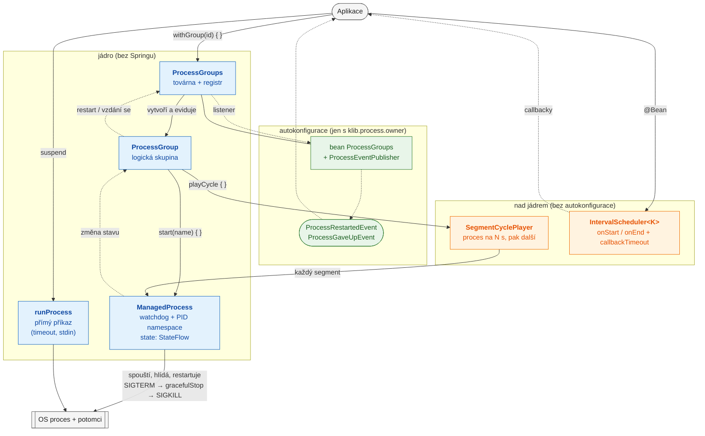

# spring-boot-process

Správa externích procesů (přehrávače, Chromium, LibreOffice…) pro Spring Boot aplikace — jádro jde použít i bez Springu.

- **`ProcessSpec`** — neměnný popis procesu (příkaz, název, env, pracovní adresář, výstup, `RestartPolicy`,
  `gracefulStop`); v DSL `processSpec { }`.
- **`ManagedProcess`** — watchdog s restarty podle `RestartPolicy` (nulování po stabilním běhu); každý běh má vlastní
  PID namespace, který se při stopu ukončí (SIGTERM → `gracefulStop` → SIGKILL; `Duration.ZERO` = rovnou SIGKILL), rotace logu,
  `state: StateFlow<ProcessState>`. Nepoužívaný stdin se při startu uzavře, proces dostane EOF.
- **`ProcessGroup`** — procesy jedné jednotky práce. Název procesu je ve skupině klíčem. `stop()` zastaví navázané
  cykly a vlastní PID namespaces. `stop()` z callbacku `Restarting` nečeká sám na watchdog; úklid doběhne po návratu
  z callbacku.
- **`ProcessGroups`** — továrna a registr skupin (`withGroup`, `create`, `find`), pojistka `close()`. Ve Spring Bootu
  bean z autokonfigurace, který publikuje `ProcessRestartedEvent`
  a `ProcessGaveUpEvent` (s Micrometerem z nich počítadla `klib.process.restarts` / `klib.process.gave_up`); bez Springu
  `processGroups { }`. Spring property `owner` identifikuje jen události a metriky.
- **`runProcess`** — jednorázový příkaz (suspend), souběžné čtení výstupu se stropem, timeout s jistým návratem,
  stdin, `checkSuccess()`. Výchozí je přímé spuštění (timeout a zrušení ukončí jen přímý proces, funguje `sudo`);
  `isolated = true` ho spustí v PID namespace jako `ManagedProcess` — s příkazem skončí i jeho potomci.
- **`SegmentCyclePlayer`** — cyklus „proces na N sekund, pak další“; `segment(duration) { }` je popis,
  co právě hraje, ukazuje `nowPlaying`. Ve skupině `group.playCycle { }` — skončí se skupinou.
- **`IntervalScheduler<K>`** — intervaly s párovanými `onStart`/`onEnd(EndReason)` se stropem `callbackTimeout`
  (výchozí 30 s), odolné proti skoku hodin a letnímu času (neautokonfiguruje se, deklaruj `@Bean`).



Plné čáry = volání, přerušované = události, stavy a úklid.

## Konfigurace

```properties
klib.process.owner=my-app                  # identifikátor metrik/událostí; bez něj se autokonfigurace nezapne
klib.process.logs-directory=/var/log/my-app # pro logToFile() / ProcessGroup.logFile(name)
klib.process.restart.max-restarts=30
klib.process.restart.delay=3s
klib.process.restart.stable-run=10m
klib.process.graceful-stop=5s
klib.process.shutdown-timeout=8s
```

Výchozí hodnoty `klib.process.*` dosazuje DSL `group.start(name) { }`; `group.start(spec: ProcessSpec)` bere spec tak,
jak je.

## Použití

```kotlin
// skupina na dobu akce — stop ve finally, i při zrušení korutiny
suspend fun play(action: Action) = processGroups.withGroup("action-${action.id}") {
    start("chromium") {
        command("chromium", "--kiosk") { option("--app=", action.url); flag("--incognito", action.private) }
        env("DISPLAY", ":0")
        logToFile()                                  // <logs-directory>/chromium.log
        restart { maxRestarts = 10 }                 // úprava výchozí politiky z klib.process.restart.*
        onGaveUp { showErrorScreen(action, it) }     // z vlákna watchdogu; smí skupinu zastavit
    }
    playCycle("slides-${action.id}") {               // běží, dokud se akce nezruší nebo skupina nezastaví
        playlist.load(action).map { item ->
            segment(item.duration) {
                command("mpv", "--fs", item.file.path)
                prepare { removeStaleLocks(item) }
                whilePlaying { paginator.run(item) }
            }
        }
    }
}

// jednorázový přímý příkaz; env nastav volitelně přes DSL
val seconds = runProcess("ffprobe", "-v", "error", "-show_entries", "format=duration", "-of", "csv=p=0", file.path) {
    timeout = 10.seconds
}.checkSuccess().output.trim().toDouble()

runProcess(sudo("/usr/bin/systemctl", "restart", "display")) { timeout = 20.seconds }.checkSuccess()

// interval s párovaným koncem
scheduler.schedule(action.id, action.start, action.end) {
    awaitReady { downloads.await(action) }
    onStart { handle -> conflicts.preempt(action, handle); runner.start(action) }
    onEnd { reason ->
        runner.stop(action)
        if (reason == EndReason.Ended || reason == EndReason.Cancelled) plans.markFinished(action.id)
    }
}

@EventListener
fun onGaveUp(event: ProcessGaveUpEvent) { /* event.groupId, event.giveUp */ }

@EventListener
fun onRestarted(event: ProcessRestartedEvent) { /* event.groupId, event.name, event.restarts, event.exitCode */ }
```

Bez Springu: `val groups = processGroups { logsDirectory = …; onGaveUp { group, giveUp -> … } }`,
při vypnutí `groups.close()`. `owner` v Spring konfiguraci slouží pouze jako štítek událostí a metrik.

## Spravované procesy: povinný PID namespace

Každý `ManagedProcess` i segment cyklu běží na Linuxu výhradně přes
`unshare --user --map-current-user --pid --fork --kill-child --mount-proc /usr/bin/tini -g -- <příkaz>`. Není to volitelný DSL
přepínač. Vyžaduje `unshare` z `util-linux`, spustitelný `/usr/bin/tini` a runtime, který povolí user/PID namespaces.
`tini` je PID 1 uvnitř namespace; při jeho konci jádro uklidí i potomky odpojené přes `setsid`, bez hledání v `/proc`
nebo env tagů.

Při `stop()` posílá knihovna SIGTERM přímo vnitřnímu `tini -g` a čeká po `gracefulStop`; při timeoutu zabije wrapper
`unshare`, takže `--kill-child` ukončí namespace SIGKILL. `Duration.ZERO` wrapper ukončí rovnou. Debian util-linux
2.41.5 ignoruje SIGTERM poslaný wrapperu a nepředává ho. Konec hlavního programu vždy ukončí i jeho potomky — včetně
launcheru s `RestartPolicy.NEVER`, který dříve mohl nechat odpojené procesy běžet.

Spring autokonfigurace po startu spustí `checkPidNamespaceSupport()` (stejný `unshare … true`); když runtime namespace
nepovolí, zaloguje ERROR `Managed processes will not start`. Aplikaci záměrně neshodí — AOT trénink v `docker build`
běží s výchozím seccompem, kde `unshare --user` končí `EPERM`. Bez Springu lze funkci zavolat ručně.

`--kill-child` váže procesy na wrapper `unshare`, ne přímo na JVM. Samotný pád JVM proto namespace nezastaví, pokud
wrapper stále žije; v CDC je úklid navázán na zastavení celého kontejneru.

`--mount-proc` připojí uvnitř vlastní `/proc`, takže `/proc/<getpid()>` (`/proc/$$` ve skriptech) ukazuje na proces
v namespace — se zděděným `/proc` kontejneru by PID 2 uvnitř byl cizí proces. Vyžaduje mount namespace a
`--security-opt systempaths=unconfined` (jinak `mount /proc failed: EPERM`; jádro nedovolí nový procfs, když je
v kontejneru část `/proc` zamaskovaná). Mount namespace je private: mount hostitele/kontejneru vzniklý až po startu
procesu (CIFS) běžící proces neuvidí — namountovat před startem.
Na hostiteli s AppArmor (Ubuntu, Debian) navíc `--security-opt apparmor=unconfined`: profil `docker-default` má
`deny mount` a `unshare` skončí `cannot change root filesystem propagation: Permission denied`. Ubuntu od 23.10
k tomu omezuje user namespaces (`kernel.apparmor_restrict_unprivileged_userns=1`) — pak je nutné nastavit `0`.

Mapování `--map-current-user` neukazuje doplňkové GID jako názvy zařízení (`id -Gn` vracelo `nogroup`), ale test
skutečných oprávnění potvrdil čtení souboru `root:video`. To samo o sobě neověřuje přístup k zařízením. Testovací image
nemá Wayland ani hardware. Na RPi s CDC (2026-11-08) ověřeno přehrávání videa (mpv), Chromia i LibreOffice
v namespace — Wayland, GPU a user namespace fungují.

`runProcess` je ve výchozím stavu přímé spuštění mimo PID namespace, aby zůstaly funkční krátké systémové příkazy
včetně `sudo` a mountů (v user namespace se setuid ignoruje). Timeout či zrušení ukončí pouze přímý proces. Příkaz
s potomky (pipeline `sh -c "a | b"`, launcher) spusť s `isolated = true`: konec, timeout i zrušení pak ukončí celý
namespace a výstup se vrátí hned, bez čekání na potomka držícího rouru.

```kotlin
group.runProcess(listOf("sh", "-c", "piper --output-raw | aplay -")) {
    isolated = true
    stdin(text)
}
```

`dockerTest` ověřuje celý Linux test suite na CDC-like image (Debian trixie, JRE 25, uid 1000, skupiny zařízení,
`tini -s`, shell s `exec java`). Před spuštěním `dockerTestPreflight` ověří namespace; bez něj se `dockerTest`
přeskočí s varováním, s `-Pklib.process.requirePidNamespace=true` (GoCD) build selže. Používá stejné
capabilities/security options jako CDC (včetně `apparmor=unconfined`), bez `--privileged` a bez hostitelských cgroups. Testovací image nemá Wayland ani skutečná zařízení; obsahuje Chromium a LibreOffice Impress pro testy
se skutečnými aplikacemi (headless).

Verzi lze lokálně publikovat pro CDC přes `./gradlew :spring-boot-process:publishToMavenLocal`; běžná publikace do
GitHub Packages používá `./gradlew :spring-boot-process:publish`.

## Omezení

- Spravované procesy jsou podporované pouze na Linuxu s dostupným `unshare`, `/usr/bin/tini` a povolenými user/PID
  namespaces. Pád JVM bez ukončení kontejneru může zanechat wrapper běžet.
- `runProcess` bez `isolated` nespravuje potomky; s `isolated` nejde `sudo`. Po timeoutu nečeká na přímý proces, který neukončí ani SIGKILL (nepřerušitelné I/O,
  zaseknutý síťový mount) — vrátí `exitValue = null`.

## Testy

```bash
./gradlew :spring-boot-process:test        # host; testy spravovaných procesů se bez PID namespace (macOS) přeskočí
./gradlew :spring-boot-process:dockerTest  # celý Linux suite; bez user/PID namespace v Dockeru se přeskočí s varováním
./gradlew :spring-boot-process:dockerTest -Pklib.process.requirePidNamespace=true  # namespace povinný, jinak chyba
```
