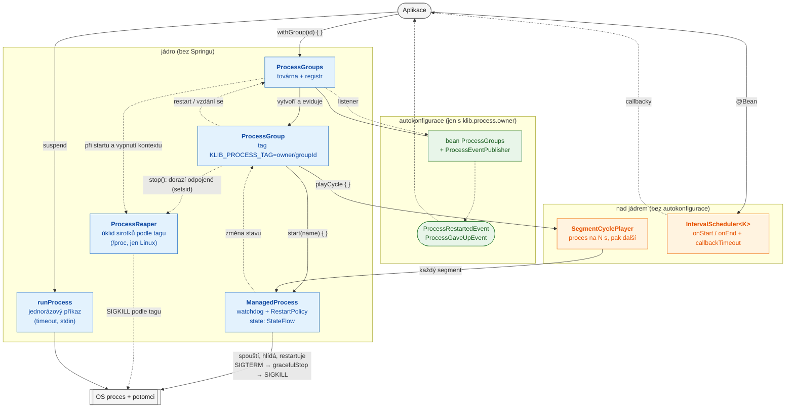

# spring-boot-process

Správa externích procesů (přehrávače, Chromium, LibreOffice…) pro Spring Boot aplikace — jádro jde použít i bez Springu.

- **`ProcessSpec`** — neměnný popis procesu (příkaz, název, env, pracovní adresář, výstup, `RestartPolicy`,
  `gracefulStop`); v DSL `processSpec { }`.
- **`ManagedProcess`** — watchdog s restarty podle `RestartPolicy` (nulování po stabilním běhu), stop celého
  stromu (SIGTERM → `gracefulStop` → SIGKILL), rotace logu, `state: StateFlow<ProcessState>`.
- **`ProcessGroup`** — procesy jedné jednotky práce; všechny nesou env `KLIB_PROCESS_TAG=<owner>/<groupId>`
  (dědí ho i potomci). Název procesu je ve skupině klíčem. `stop()` zastaví navázané cykly, procesy a podle tagu
  dorazí i odpojené sirotky (`setsid`).
- **`ProcessGroups`** — továrna a registr skupin (`withGroup`, `create`, `find`), úklid sirotků vlastníka
  (`reapOrphans`), pojistka `close()`. Ve Spring Bootu bean z autokonfigurace, který publikuje `ProcessRestartedEvent`
  a `ProcessGaveUpEvent` (s Micrometerem z nich počítadla `klib.process.restarts` / `klib.process.gave_up`); bez Springu
  `processGroups(owner) { }`.
- **`runProcess`** — jednorázový příkaz (suspend), souběžné čtení výstupu se stropem, timeout s jistým návratem,
  stdin, `checkSuccess()`.
- **`SegmentCyclePlayer`** — cyklus „proces na N sekund, pak další“; `segment(duration) { }` je popis,
  co právě hraje, ukazuje `nowPlaying`. Ve skupině `group.playCycle { }` — skončí se skupinou.
- **`IntervalScheduler<K>`** — intervaly s párovanými `onStart`/`onEnd(EndReason)` se stropem `callbackTimeout`
  (výchozí 30 s), odolné proti skoku hodin a letnímu času (neautokonfiguruje se, deklaruj `@Bean`).



Plné čáry = volání, přerušované = události, stavy a úklid.

## Konfigurace

```properties
klib.process.owner=my-app                  # vlastník tagu, dvě aplikace si nezabíjí procesy; bez něj se autokonfigurace nezapne
klib.process.logs-directory=/var/log/my-app # pro logToFile() / ProcessGroup.logFile(name)
klib.process.restart.max-restarts=30
klib.process.restart.delay=3s
klib.process.restart.stable-run=10m
klib.process.graceful-stop=5s
klib.process.reap-orphans-on-startup=true
klib.process.shutdown-timeout=8s
```

Výchozí hodnoty `klib.process.*` dosazuje DSL `group.start(name) { }`; `group.start(spec: ProcessSpec)` bere spec tak,
jak je.

## Použití

```kotlin
// skupina na dobu akce — stop ve finally, i při zrušení korutiny
suspend fun play(action: Action) = processGroups.withGroup("action-${action.id}") {
    start("chromium") {
        command("chromium", "--kiosk") { option("--app=", action.url); flag("--incognito", action.private) }
        env("DISPLAY", ":0")
        logToFile()                                  // <logs-directory>/chromium.log
        restart { maxRestarts = 10 }                 // úprava výchozí politiky z klib.process.restart.*
        onGaveUp { showErrorScreen(action, it) }     // z vlákna watchdogu; smí skupinu zastavit
    }
    playCycle("slides-${action.id}") {               // běží, dokud se akce nezruší nebo skupina nezastaví
        playlist.load(action).map { item ->
            segment(item.duration) {
                command("mpv", "--fs", item.file.path)
                prepare { removeStaleLocks(item) }
                whilePlaying { paginator.run(item) }
            }
        }
    }
}

// jednorázový příkaz; ve withGroup { } dostane tag skupiny automaticky
val seconds = runProcess("ffprobe", "-v", "error", "-show_entries", "format=duration", "-of", "csv=p=0", file.path) {
    timeout = 10.seconds
}.checkSuccess().output.trim().toDouble()

runProcess(sudo("/usr/bin/systemctl", "restart", "display")) { timeout = 20.seconds }.checkSuccess()

// interval s párovaným koncem
scheduler.schedule(action.id, action.start, action.end) {
    awaitReady { downloads.await(action) }
    onStart { handle -> conflicts.preempt(action, handle); runner.start(action) }
    onEnd { reason ->
        runner.stop(action)
        if (reason == EndReason.Ended || reason == EndReason.Cancelled) plans.markFinished(action.id)
    }
}

@EventListener
fun onGaveUp(event: ProcessGaveUpEvent) { /* event.groupId, event.giveUp */ }

@EventListener
fun onRestarted(event: ProcessRestartedEvent) { /* event.groupId, event.name, event.restarts, event.exitCode */ }
```

Bez Springu: `val groups = processGroups("my-app") { logsDirectory = …; onGaveUp { group, giveUp -> … } }`,
při startu `groups.reapOrphans()`, při vypnutí `groups.close()`.

## Kontejnery — init je nutný

Osiřelé potomky (rodič skončil) adoptuje PID 1. Bez initu je nikdo neuklidí a hromadí se zombie —
spouštěj kontejner s `docker run --init` nebo `ENTRYPOINT ["/usr/bin/tini", "-s", "--"]`.

## Omezení

- Úklid podle tagu čte `/proc/<pid>/environ` — jen Linux; na macOS/Windows je `ProcessReaper` no-op. Totéž platí
  pro úklid potomků, kteří přežili pád rodiče (env `KLIB_PROCESS_INSTANCE`), před restartem watchdogu.
- Procesy pod `sudo` reaper nenajde: sudo resetuje env (nenesou tag ani `KLIB_PROCESS_INSTANCE`) a jako root nejsou
  čitelné. `stop()` je ukončí přes strom (sudo předá SIGTERM).
- `runProcess` po timeoutu nečeká na proces, který neukončí ani SIGKILL (nepřerušitelné I/O, zaseknutý síťový mount)
  — vrátí `exitValue = null`.

## Testy

```bash
./gradlew :spring-boot-process:test        # host (i macOS) — Linux testy se přeskočí
./gradlew :spring-boot-process:dockerTest  # vše v kontejneru (src/dockerTest/Dockerfile), check na něm závisí
```
